  

### Overview

I am a **Full-Stack &amp; Systems Engineer** specializing in agentic AI architecture, serverless developer tooling, and financial software. My work focuses on building high-performance, low-latency web platforms and bridging open-weight models with practical production workflows:

* **Autonomous AI Architecture:** Reference Model Context Protocol (MCP) servers, multi-platform agent harnesses, and low-latency inference routing.
* **Serverless Developer Tooling:** Browser-native workstations that eliminate backend costs and operational overhead without sacrificing speed.
* **Domain Platforms:** Specialized financial reconciliation workflows for Indian SMEs and astronomical computation engines on Cloudflare Workers.

---

### Featured Systems &amp; Applications

| Project | Architectural Domain | Description &amp; Key Technologies | Production Links |
| :--- | :--- | :--- | :--- |
| **[FreeLLM Hub](https://github.com/Omi811/freellm-hub)** | Serverless AI Workstation | 100% free, client-side web LLM suite featuring Claude-style interactive code/HTML artifacts canvas, 42+ frontier models, and Groq LPU hardware-accelerated streaming (~450 tok/s). `JavaScript` • `Serverless` • `WebLLM` • `GitHub Pages` | [🚀 Live Workstation](https://omi811.github.io/freellm-hub/) [📂 Source Repository](https://github.com/Omi811/freellm-hub) |
| **[Omsetra](https://github.com/Omi811/omsetra)** | Fintech Reconciliation Workspace | Free-first automated reconciliation and collections workspace engineered for Indian founders, SMEs, and accountants. Provides automated ledger parsing, invoice discrepancy tracking, and payment reminders. `TypeScript` • `Next.js` • `Fintech Rails` • `Tailwind CSS` | [📊 Interactive Demo](https://astrobharat-studio.hp909145.chatgpt.site/demo) [📂 Source Repository](https://github.com/Omi811/omsetra) |
| **[REA Developer Ecosystem](https://github.com/Omi811/rea-developer-ecosystem)** | Agentic Infrastructure &amp; Protocols | Reverse-engineered architecture blueprints and reference Model Context Protocol (MCP) servers for autonomous AI engineering environments. `TypeScript` • `MCP (Model Context Protocol)` • `Docker` • `Blueprints` | [🛠️ Architecture Specs](https://github.com/Omi811/rea-developer-ecosystem) |
| **[Universal SEO Agent Suite](https://github.com/Omi811/universal-seo-agent-suite)** | Cross-Platform GEO Engine | Generative Engine Optimization (GEO) suite comprising 60+ hardened audit tools running across Google Antigravity, OpenAI Codex, and Claude Code to maximize citations in AI Overviews and Perplexity. `Python` • `SQLite` • `Agentic Workflows` • `MCP` | [🧭 Agent Suite Specs](https://github.com/Omi811/universal-seo-agent-suite) |
| **[VedaaChari](https://vedaachari.ompanchal.workers.dev)** | Astronomical Computation Platform | Production Vedic astrology and personal reflection platform deployed on Cloudflare Workers. Computes sidereal birth charts, Vimshottari Dasha periods, and astronomical Panchang with zero mandatory signup and local data ownership. `TypeScript` • `Cloudflare Workers` • `Astronomical Algorithms` • `SaaS` | [🚀 Production Platform](https://vedaachari.ompanchal.workers.dev) [✨ Interactive Demo](https://vedaachari.ompanchal.workers.dev/report-demo) |
| **[Referral &amp; Rewards Portal](https://github.com/Omi811/Accredian-frontend-task)** | Interactive Conversion Engine | Production referral interface built with Material-UI and Framer Motion, featuring accessible animated modal dialogs, reactive form validation, and responsive promotional landing components. `React` • `Material-UI` • `Framer Motion` • `Vercel` | [✨ Production Deployment](https://accredian-frontend-task-ochre.vercel.app) [📂 Source Repository](https://github.com/Omi811/Accredian-frontend-task) |

---

### Technical Competencies

| Layer | Technologies &amp; Frameworks |
| :--- | :--- |
| **Languages** | `TypeScript` `JavaScript (ESNext)` `Python 3.12` `SQL` `HTML5/CSS3` |
| **AI &amp; Agent Systems** | `Model Context Protocol (MCP)` `Groq LPU Hardware Acceleration` `OpenRouter` `Streaming APIs (SSE)` |
| **Frontend Architecture** | `React 19` `Next.js (App Router)` `Tailwind CSS` `Framer Motion` `Material-UI` |
| **Backend &amp; Distributed Systems** | `Node.js` `Cloudflare Workers` `FastAPI` `Fastify/Express` `RESTful & JSON-RPC APIs` |
| **Infrastructure &amp; Tooling** | `Docker` `Git` `GitHub Actions (CI/CD)` `Vercel` `SQLite` `PostgreSQL` |

---

### Engineering Activity &amp; Metrics

  
  &nbsp;&nbsp;
  

---

### Support &amp; Open-Source Patronage

If you find my open-source AI tooling, serverless applications, or architectural blueprints useful, you can support continuous maintenance and cloud infrastructure:

  
  &nbsp;&nbsp;&nbsp;&nbsp;
  

---

  © 2026 Omi · Open to high-impact software engineering roles and technical collaborations.

